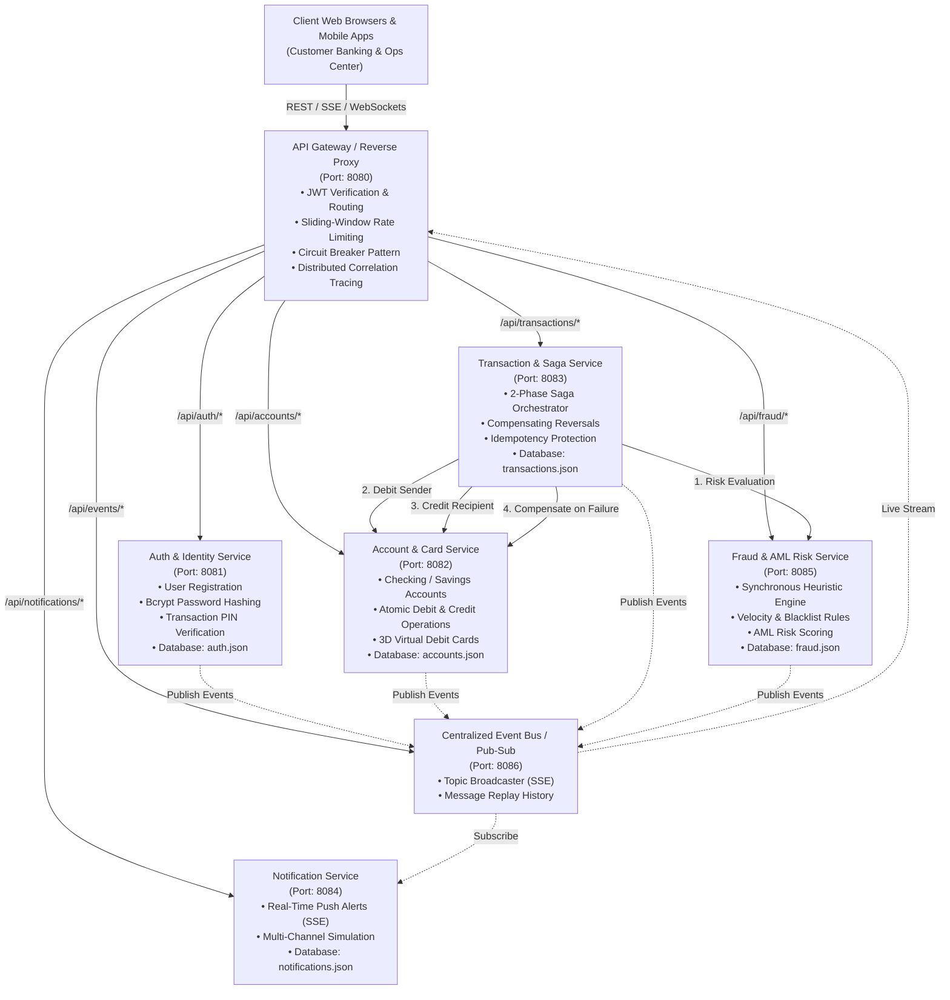

# Apex Internet Banking — Microservices Architecture

> Production-grade, resilient Internet Banking platform built using an Event-Driven Microservices Architecture with an API Gateway, Saga Pattern Distributed Transactions, Real-time Pub/Sub Event Broker, and an Interactive Operations Control Center.

---

## 🏛️ System Architecture



---

## 🚀 Key Microservices Patterns Implemented

| Pattern | Implementation in Apex Banking |
| :--- | :--- |
| **API Gateway** | Single public entrypoint (`:8080`) routing traffic downstream, managing JWT validation, circuit breaking, request logging, and rate limiting. |
| **Database-per-Service** | Each microservice strictly owns its own isolated JSON/file datastore (`data/*.json`) with ACID file locking. No shared database across services. |
| **Distributed Saga Orchestrator** | Coordinates multi-service transfers without distributed two-phase locking. If recipient credit fails, executes automated **compensating transactions** to refund the sender. |
| **Event-Driven Pub/Sub** | Centralized broker (`:8086`) broadcasting domain events (`TRANSACTION_COMPLETED`, `FRAUD_ALERT_RAISED`, `USER_REGISTERED`) to asynchronous listeners. |
| **Circuit Breaker** | Monitored downstream health with automatic trip-to-open on failures, protecting cascading failures and recovering gracefully. |
| **Idempotency Keys** | Prevents duplicate charges from rapid double-clicks using `idempotency-key` request headers. |
| **Synchronous AML Rule Engine** | Real-time heuristic risk analysis assessing velocity, rapid balance drain, high-value thresholds, and blacklists. |

---

## 📦 Microservices Directory & Port Map

| Service Name | Port | Directory | Core Responsibilities |
| :--- | :---: | :--- | :--- |
| **API Gateway** | `8080` | `services/api-gateway` | Reverse proxy, static UI host, JWT, circuit breaker, system topology |
| **Auth Service** | `8081` | `services/auth-service` | Login, registration, JWT issuance, password hashing, Transaction PIN |
| **Account Service** | `8082` | `services/account-service` | Checking/Savings balance, atomic debit/credit, card controls |
| **Transaction Service** | `8083` | `services/transaction-service` | Fund transfers, Saga Orchestrator, compensating rollbacks |
| **Notification Service** | `8084` | `services/notification-service` | In-app alerts, real-time SSE push alerts to web clients |
| **Fraud & Risk Service** | `8085` | `services/fraud-service` | Real-time AML heuristics, risk scoring (0-100), alert resolution |
| **Event Bus (Pub/Sub)** | `8086` | `services/event-bus` | Centralized message broker, SSE streaming, audit log buffer |

---

## ⚡ Quick Start Guide

### Prerequisites
- **Node.js** (v18.x or later)
- **npm** (v9.x or later)

### 1. Install Dependencies
```bash
npm install
```

### 2. Seed Databases (Optional - pre-seeded out of the box)
```bash
npm run seed
```

### 3. Start All Microservices
```bash
npm start
```
*This command runs `runner.js`, which concurrently spawns all 7 microservices, checks their health until online, and prints the cluster endpoints.*

### 4. Open in Browser
- **Internet Banking & Ops Console**: [http://localhost:8080](http://localhost:8080)
- **Live System Topology JSON**: [http://localhost:8080/api/system/topology](http://localhost:8080/api/system/topology)
- **Event Bus Stream**: [http://localhost:8086/events/stream](http://localhost:8086/events/stream)

---

## 🧪 Run Automated Integration & Saga Tests

Execute the comprehensive test suite verifying service discovery, JWT security, 2-phase Saga execution, and automated compensation rollbacks:

```bash
npm test
```

Expected test run output:
```
🧪 RUNNING APEX INTERNET BANKING MICROSERVICES TEST SUITE
  ✅ PASS: Gateway /api/system/topology is reachable
  ✅ PASS: API Gateway status is ONLINE
  ✅ PASS: Microservice [auth] is healthy & responding
  ✅ PASS: Microservice [accounts] is healthy & responding
  ✅ PASS: Microservice [transactions] is healthy & responding
  ✅ PASS: Microservice [notifications] is healthy & responding
  ✅ PASS: Microservice [fraud] is healthy & responding
  ✅ PASS: Microservice [events] is healthy & responding
  ✅ PASS: User login succeeds with HTTP 200
  ✅ PASS: JWT access token issued
  ✅ PASS: Transaction PIN "1234" correctly validated
  ✅ PASS: Transfer Saga executed with HTTP 200
  ✅ PASS: Transfer finalized as COMPLETED
  ✅ PASS: Saga Step 1: VALIDATE_REQUEST executed
  ✅ PASS: Saga Step 2: FRAUD_EVALUATION executed
  ✅ PASS: Saga Step 3: DEBIT_SENDER executed
  ✅ PASS: Saga Step 4: CREDIT_RECIPIENT executed
  ✅ PASS: Saga Step 5: FINALIZE_LEDGER executed
  ✅ PASS: Sender balance accurately debited by $100
  ✅ PASS: Failed transaction detected & marked FAILED_ROLLED_BACK
  ✅ PASS: Compensating transaction executed
  ✅ PASS: Sender balance 100% restored after compensation refund
  ✅ PASS: Suspicious transfer rejected by Gateway/Saga
  ✅ PASS: Transfer explicitly flagged as BLOCKED_FRAUD
  ✅ PASS: Notifications endpoint active
📊 TEST RESULTS: 24 PASSED, 0 FAILED
```

---

## 👤 Pre-configured Demo Personas

| Persona | Email | Password | PIN | Role & Assets |
| :--- | :--- | :--- | :---: | :--- |
| **John Doe** | `john.doe@bank.com` | `Password123!` | `1234` | Primary customer with Checking (`4010882314`) & Savings (`4088921105`), Visa Platinum card |
| **Sarah Connor** | `sarah.connor@bank.com` | `Password123!` | `5678` | Recipient demo customer with Checking (`4055239912`), Mastercard Gold |
| **Marcus Vance** | `admin@bank.com` | `AdminSecret123!` | `9999` | Chief Compliance Auditor (Review AML alerts, inspect system topology) |

---

## 🔄 The Saga Orchestration Workflow

When a customer transfers funds between accounts, the Transaction Service acts as the **Saga Coordinator**:

1. **Phase 1: Validation**: Verifies sender balance, account active states, and checks idempotency key.
2. **Phase 2: Risk Scoring**: Calls Fraud Service (`POST /fraud/evaluate`). If risk score $\ge 80$, the transfer is immediately rejected (`BLOCKED_FRAUD`).
3. **Phase 3: Debit Sender**: Atomically deducts funds from sender's account via Account Service (`POST /accounts/debit`).
4. **Phase 4: Credit Recipient**: Credits funds to recipient's account (`POST /accounts/credit`).
5. **Compensating Action (if Phase 4 fails)**:
   - If recipient's account is closed, frozen, or network times out, the Orchestrator initiates an immediate **Compensating Transaction**:
   - `POST /accounts/credit` back to sender's account with reversal reference ID.
   - Status updated to `FAILED_ROLLED_BACK`.
6. **Phase 5: Finalize & Broadcast**: Persists immutable transaction record and publishes `TRANSACTION_COMPLETED` event to the Event Bus.
7. **Phase 6: Asynchronous Notifications**: Notification Service receives event and delivers real-time push alert to browser SSE stream.

---

## 🐳 Docker Deployment

To spin up all 7 microservices in isolated Docker containers:

```bash
docker-compose up --build
```
Access the application on `http://localhost:8080`.
